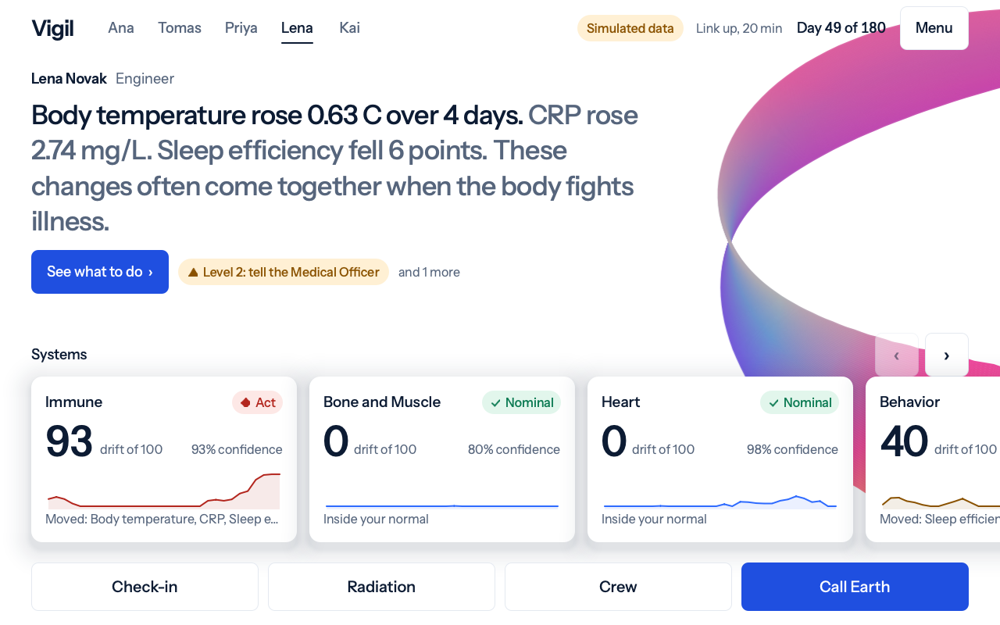
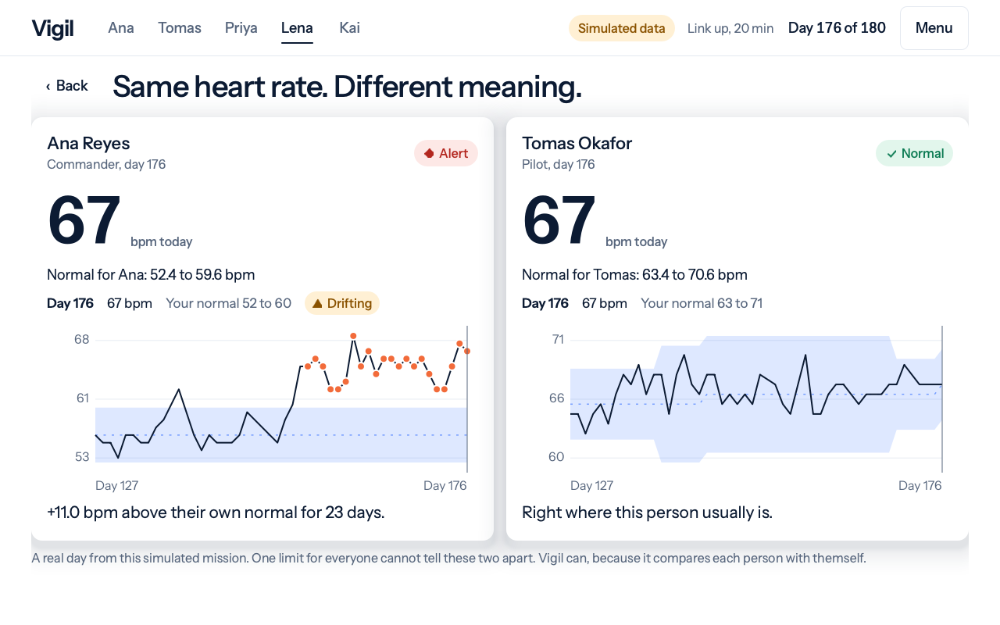

# Vigil

An offline health monitor for long missions. It learns each astronaut's own normal, finds drift across many signals, explains it in plain words, and decides when to call Earth.

A message to Mars can take about 20 minutes each way, so the astronaut cannot wait for ground staff.



**All crew data is synthetic. Thresholds are starting values, not clinical limits. Vigil gives decision support, not a diagnosis.** See [LIMITATIONS.md](LIMITATIONS.md).

Built for the NASA Space Apps Challenge 2026, Phoenix.

## What it is

Vigil is native desktop software built on Qt 6. It is not a web page and has no browser inside. The interface and the engine run in one process, with no server and no open network ports. It runs on Linux, macOS and Windows, on x86-64 or ARM64.

## Run it

You need Python 3.11 or newer and `make`.

```bash
make setup
```

```bash
make demo
```

| Command | What it does |
|---|---|
| `make dev` | Opens Vigil and the Mission Control window |
| `make demo` | Opens Vigil and plays the Demo Director, about 2 minutes |
| `make kiosk` | Runs fullscreen for a dedicated panel |
| `make test` | Runs all tests, including every screen, with no display needed |
| `make eval` | Reruns the 20-mission evaluation and updates `docs/results.md` |
| `make package` | Builds a standalone folder in `dist/vigil` that needs no Python |
| `make screenshots` | Renders every screen to `docs/screens` |

### On Linux

Ubuntu 24.04 needs these system libraries:

```bash
sudo apt-get install -y python3-venv make libegl1 libgl1 libopengl0 libglib2.0-0t64 libdbus-1-3 libfontconfig1 libfreetype6 libxkbcommon0
```

`make package` also needs `libpython3.12` and `binutils`.

A computer with no desktop environment can draw straight to the display:

```bash
.venv/bin/python frontend/main.py --kiosk --platform eglfs
```

`packaging/Dockerfile.linux` builds and tests Vigil on real Linux. Build `make package` on the same operating system and CPU type you will run on.

Before any demo, this confirms the interface loads cleanly:

```bash
.venv/bin/python frontend/main.py --check
```

### Keyboard

| Key | Action |
|---|---|
| Esc | Back |
| Ctrl+Z | Undo the last alert action |
| Ctrl+D | Play demo |
| Ctrl+Right | Next demo beat |
| Ctrl+. | Stop demo |
| Ctrl+G | Open Mission Control |
| F11 | Toggle fullscreen |

The hidden Admin screen opens after five taps on the VIGIL wordmark.

## How it works

| Step | Code |
|---|---|
| A seeded generator builds a 180-day mission with 4 crew, a quiet control and 4 planted events | `backend/app/sim` |
| Robust personal baselines, then z-score, EWMA and CUSUM with a vote | `backend/app/engine/baseline.py`, `drift.py` |
| Small shifts combine into a 0 to 100 score per system | `backend/app/engine/fusion.py` |
| Escalation to Level 1, 2 or 3, with the reason in plain words | `backend/app/engine/escalation.py` |
| Plain-language alerts with a Why? view | `backend/app/engine/alerts.py` |
| Earth link with delay, priority and lost-link handling, and privacy tiers | `backend/app/sync` |
| Screen data, in process | `backend/app/views.py` |
| Interface | `frontend/qml` |

Details are in [docs/architecture.md](docs/architecture.md). Design choices are in [docs/design-principles.md](docs/design-principles.md).

## Results

The full table is in [docs/results.md](docs/results.md). It uses 20 missions that were not used for tuning.

| Measure | Result |
|---|---|
| Planted health events found | 60 of 60 |
| Solar storm warnings passed on | 20 of 20 |
| False alarms per 100 days, non-event days | Vigil 1.54, fixed limits 2.94 to 8.48 |
| Heart drift, against the quieter fixed limit | Vigil flagged it 7.1 days sooner on average, and the fixed limit missed 5 of 20 runs |
| Immune and behavior events | A fixed limit was about as fast |

These numbers come from events we planted in data we generated. They show the method works in simulation and say nothing about real people.



## Files

| File | Contents |
|---|---|
| [PLAN.md](PLAN.md) | The plan |
| [PROGRESS.md](PROGRESS.md) | What was done, phase by phase |
| [DECISIONS.md](DECISIONS.md) | Choices the brief left open |
| [SOURCES.md](SOURCES.md) | Sources and numbers the team must verify |
| [LIMITATIONS.md](LIMITATIONS.md) | What this does not show |
| [docs/pitch.md](docs/pitch.md) | 3-minute pitch |
| [docs/demo-script.md](docs/demo-script.md) | Click-by-click demo |
| [docs/qa.md](docs/qa.md) | Likely judge questions |
| [docs/manual-tests.md](docs/manual-tests.md) | Manual test script |
